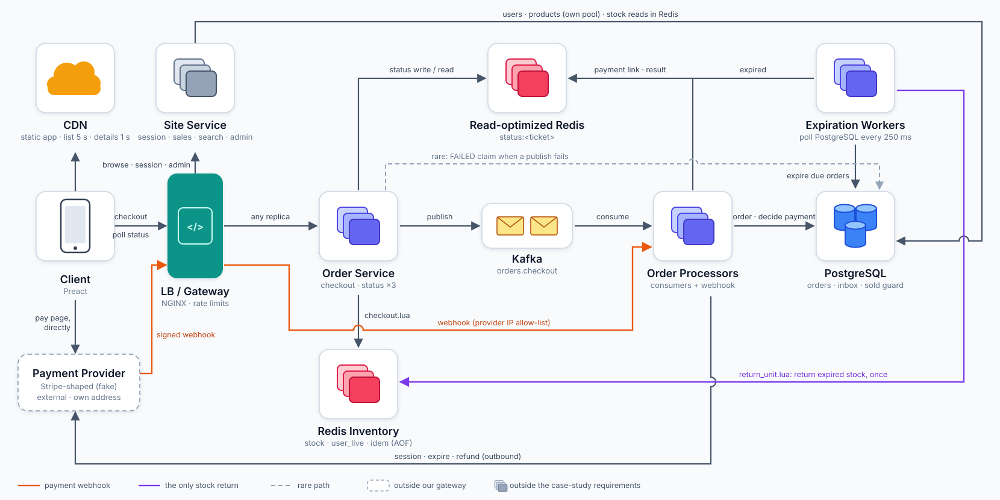

# Flash Sale

A backend and storefront for a flash sale: 500 smartphones go on sale at a fixed time, more than 100,000 requests reach checkout in the first 10 seconds, and exactly 500 units are sold, never more. Winners get an answer in milliseconds (`202 Accepted` and a queue ticket), everyone else gets `410 Gone` just as fast, and the slow parts (Kafka, order processing, payment, PostgreSQL) only ever see the roughly 500 winners. Stock is reserved by one atomic Lua script in Redis; PostgreSQL has a conditional `UPDATE` as a second line of defence. Redis gates admission only; Kafka is the queue; PostgreSQL decides every outcome.

The design is described below. How it answers the placement case study is in [CASE_STUDY.md](CASE_STUDY.md). The HTTP API is in [API_REFERENCE.md](API_REFERENCE.md).

## Architecture

| Component | What it does | Code |
|---|---|---|
| Frontend (static) | The storefront as static files: Vite builds the Preact app into `web/dist` (47.5 kB raw, 16.7 kB gzipped, hashed and immutable). It is the CDN's origin; in compose the gateway image bundles it and NGINX serves it, standing in for a CDN in front of a storage bucket | `web/`, `gateway/Dockerfile` |
| Client | The browser running that app: countdown, buy button (locks on the first click), queue and payment states, status polling every 2 s | `web/src/` |
| Gateway | NGINX on `:8000`: serves the frontend, sends checkout and status to three Order Service replicas (least connections, failover) and sessions, sale details, the list, search and admin to the site service, rate limits, bot filter, hides `/v1/admin/`, caches the site's sale routes at the edge (details 1 s, list and search 5 s), sends the webhook (from the provider's address only) to the order processors. The payment page is not behind it | `gateway/` |
| Order Service x3 | Stateless HTTP API of the case study and nothing else: `POST /v1/sales/{id}/checkout` and `GET /v1/orders/status/{ticket}`. Status is answered from the read cache only; its one PostgreSQL use is the `FAILED` claim when a Kafka publish fails | `src/bin/order_service.rs`, `src/api/checkout.rs`, `src/api/orders.rs` |
| Site service | Everything else the storefront needs, so it can never take capacity, connections or database time from checkout: guest sessions, sale details, the sale list, search by name, admin sale creation. One replica with its own small PostgreSQL pool; reads Redis only for `sold_out`, writes it only when a sale is created | `src/bin/site.rs`, `src/api/` |
| Redis (inventory) | Admission only: `stock:{sale}`, `user_live:{sale}:{user}`, the idempotency key and `sale_start:{sale}`; no per-ticket state, and it does not count sales, PostgreSQL is the record of those. Append-only file on | `scripts/*.lua`, `src/cache.rs` |
| Redis (read cache) | `status:<ticket>`, what clients poll. Its own instance (`redis-cache`, host port 6380; `READ_CACHE_URL`), with AOF and `noeviction`: the status endpoint reads only this | `src/cache.rs` |
| Kafka | Topic `orders.checkout` (6 partitions): checkout events from the Order Service to the processors | `src/queue.rs` |
| Order Processor | Turns each checkout event into an order and a payment link; serves the provider's webhook (`POST /v1/payments/webhook` on `:8081`) and confirms or refunds a paid order at once; retries unprocessed payment events from the inbox | `src/bin/order_processor.rs`, `src/processor.rs`, `src/inbox.rs` |
| Expiration Worker | Driven by PostgreSQL: expires the unpaid orders whose `expires_at` has passed in one batch `UPDATE`, then returns each order's unit to stock (`INCR stock`, clear `user_live`) once, and writes `EXPIRED` to the read cache and expires the payment session. The only place stock is returned (besides the Order Service's compensation for a failed publish) | `src/expiry.rs` |
| Fake payment provider | A service of its own (`fake_payment_provider`, fixed address `172.28.0.50`), Stripe-like: the payment page `/fake-pay/{id}`, published on its own port `localhost:8090` and outside the gateway (as a real provider is), an HTTP API to create a session (idempotent), expire and refund, and signed webhooks with retries. Owns the `fakepay:*` Redis keys | `src/bin/fake_payment_provider.rs`, `src/payment/` |
| PostgreSQL 16 | Durable record, and the only place sales are counted (`products.sold`): `users`, `products`, `orders`, `payment_inbox` | `migrations/` |



The Order Service serves only checkout and status, on Redis and Kafka; it reaches PostgreSQL only on one rare path (dashed: the `FAILED` claim when a Kafka publish fails, which no client can trigger), and status polling never does. The site service serves everything outside the case-study requirements (sessions, sale details, list, search, admin) behind the edge cache. The payment provider is outside our gateway: the browser opens its page directly, the processors call its API outbound, and only its signed webhook (orange) enters through the gateway. The processors never touch inventory keys; the expiration workers, polling PostgreSQL, are the only component that returns stock (violet).

### Request flow

1. The client loads the app and `GET /v1/sales/{id}` (the site service, cached 1 s at the gateway), creates a guest session with `POST /v1/session`, and waits for the start time.
2. `POST /v1/sales/{id}/checkout` with an `Idempotency-Key`. `checkout.lua` runs once in Redis: it checks the start time, the key, one-per-user and stock, then takes one unit and sets `user_live` (with a TTL that outlives the sale) and the idempotency key. Nothing else is stored in Redis for the ticket. No unit means `409` or `410`.
3. The Order Service publishes the checkout event to Kafka (`acks=all`, idempotent producer; the event carries the ticket, sale, user, checkout time and idempotency key), stores `status:<ticket>` as `PENDING` and answers `202 {queue_ticket_id, status_url}`. If the publish fails, PostgreSQL decides: the ticket is inserted as a `FAILED` order (`ON CONFLICT DO NOTHING`), and only if that insert created the row does the Order Service return the unit and forget the key, then answer `503`. If a row already existed (the message reached Kafka after all) the answer is the normal `202`.
4. An order processor creates the payment session and inserts the order directly as `AWAITING_PAYMENT` (with the session, link and deadline in one `INSERT`; the 5-minute payment window starts here, not at checkout). It touches no Redis inventory key. If the ticket's row is already `FAILED` it expires the session and stops. `PENDING`, the state while the message waits in Kafka, exists only in the read cache, never in PostgreSQL. The client, polling the status endpoint, gets `payment_url` and goes to pay.
5. The provider sends a signed webhook. It reaches an order processor through the gateway (only from the provider's address, and only with a valid signature). The processor stores the event in `payment_inbox` and decides at once, in one PostgreSQL transaction: `UPDATE orders SET status = 'CONFIRMED' WHERE ... AND status = 'AWAITING_PAYMENT' AND payment_session_id = $2 AND expires_at > now()` together with `UPDATE products SET sold = sold + 1 WHERE id = $1 AND sold < total_inventory`. The payment path writes no inventory key in Redis, only the read-cache status. If the order cannot be confirmed (it is already `EXPIRED` or `FAILED`, or the guard refused an in-time payment), the same transaction marks it `REFUNDED` and the processor refunds through the provider; the inbox row is marked processed only when that worked, and the inbox loop retries anything unfinished. The inbox never decides a deadline: a payment for an order still `AWAITING_PAYMENT` after its `expires_at` stays in the inbox and is retried until the expiration worker has expired the order, then refunded with no stock moved.
6. The Expiration Worker is driven by PostgreSQL: each tick one statement (`UPDATE orders SET status = 'EXPIRED' ... WHERE status = 'AWAITING_PAYMENT' AND expires_at <= now() ... FOR UPDATE SKIP LOCKED RETURNING ...`, the mirror image of the confirmation; the row lock and the one clock give exactly one winner) expires a batch. For each order returned it runs `return_unit.lua` once, without retry: `INCR stock`, and `user_live` is deleted if it still names the ticket. A Redis error is logged with the ticket and the unit is lost for the rest of the sale ([docs/FAILURE_CASES.md](docs/FAILURE_CASES.md)). Then it writes `EXPIRED` to the read cache and expires the payment session. A `CONFIRMED` order is never touched, so its unit stays taken. Several workers can run at once.

### Where the frontend runs, and how to deploy it

The frontend has no container or service of its own in this repository. It is a static build: `npm run build` in `web/` writes `web/dist` (Preact + Vite, about 17 kB gzipped, hashed file names). For local runs only, `gateway/Dockerfile` builds it and copies `web/dist` into the NGINX image, so the gateway serves the pages on `:8000` next to the API. That keeps the compose stack to one entry point, but it ties every frontend change to a gateway rebuild and puts page loads on the same NGINX that takes the checkout spike.

In production it should be deployed separately, as the diagram shows (Frontend as the CDN's origin):

1. **Build** in CI: `cd web && npm ci && npm run build`.
2. **Upload** `web/dist` to object storage (S3, GCS, R2...): first `assets/` with `Cache-Control: public, max-age=31536000, immutable` (the names are content hashes, so a file never changes), then `index.html` and `product.svg` with `Cache-Control: no-cache`, so the new page only goes live once every asset it names is there.
3. **Put a CDN in front** of the bucket and of the gateway on one domain, routing by path: `/`, `/assets/*`, `/product.svg` to the bucket; `/v1/*` to the gateway. One origin for the browser means no CORS and the session token works as it does now. The CDN can also cache the site routes (sale details 1 s, the list and search 5 s, as NGINX does here); checkout and status pass through uncached.
4. **Configure** `PUBLIC_BASE_URL` and `FRONTEND_URL` as that domain, so the payment page sends buyers back to it.
5. **Drop** the `web` build stage and the `COPY --from=web` line from `gateway/Dockerfile`, and the static `location`s from `gateway/nginx.conf`: the gateway then serves only the API.

A frontend deploy is then an upload and a purge of `index.html`, with no gateway restart, and a flood of page loads before the sale is absorbed at the edge instead of by the gateway.

## Quick start

Needs Docker with compose v2 (and Node 20+ with Chromium for the optional browser check). The first build compiles the Rust binaries and the frontend, so it takes a few minutes.

```bash
# Start: PostgreSQL, two Redis (inventory, read cache) and Kafka, then the app:
# 3 Order Services, the site service, order processor, expiration worker,
# fake payment provider (:8090) and NGINX (:8000)
docker compose up -d
docker compose --profile app up -d --build

# Check it answers
curl -s localhost:8000/gateway-health          # ok
curl -s localhost:8000/v1/sales                # [] on a fresh database

# Create a sale that opens in a minute; open the link it prints
scripts/create_sale.sh

# Optional: buy one end to end in a real browser (screenshots in web/demo-shots/)
(cd web && npm install && npm run demo)

# Stop the app (data kept), or remove everything including the data
docker compose --profile app stop gateway order-service-1 order-service-2 order-service-3 site order-processor expiration-worker fake-payment-provider
docker compose down -v
```

<http://localhost:8000> lists the sales still selling, with a search box; each links to its page, `/?sale=<id>`. Buying sends you to the fake provider's payment page (`http://localhost:8090/fake-pay/...`, outside the gateway, as a real provider would be); after paying, its webhook arrives within a second or so and the order becomes `CONFIRMED`. `docker compose --profile app stop` alone would also stop PostgreSQL, Redis and Kafka.

## Creating sales

`scripts/create_sale.sh [name] [units] [price_cents] [opens_in_seconds]` creates a sale and prints it with its page link. The defaults are `Phone`, 500 units, `49900` ($499.00) and 60 seconds:

```bash
scripts/create_sale.sh                            # Phone, 500 units, $499.00, opens in 60 s
scripts/create_sale.sh "Pixel 10" 3 79900 30      # 3 units at $799.00, opens in 30 s
scripts/create_sale.sh "Open now" 10 19900 0      # opens immediately
ADMIN_TOKEN=... scripts/create_sale.sh            # another admin token (default: dev-admin-token from .env)
```

The admin route is refused from the host with `403` on purpose, so the script posts from inside the gateway container. Without the gateway (services run with cargo), post to the site service on `:8082` directly; see [Running locally with cargo](#running-locally-with-cargo).

## Running locally with cargo

```bash
docker compose up -d                  # infrastructure only
cargo run --bin order_service         # :8080; runs the migrations and creates the topic, so start it first
cargo run --bin site                  # :8082; sessions, sales, search, admin
cargo run --bin fake_payment_provider # :8090; the payment page and the provider API, delivers webhooks
cargo run --bin order_processor       # :8081 serves the webhook (the provider posts to it directly)
cargo run --bin expiration_worker
```

`.env` holds the development values and is loaded by every binary (`PUBLIC_BASE_URL=http://localhost:8080`, the payment page at `PAYMENT_PAGE_BASE_URL=http://localhost:8090`, the provider's API at `PAYMENT_PROVIDER_URL=http://127.0.0.1:8090`, webhooks to `PAYMENT_WEBHOOK_URL=http://127.0.0.1:8081/v1/payments/webhook`). Without the gateway, call the services directly: checkout and status on `:8080`, everything else, including the admin route, on `:8082`:

```bash
curl -s -X POST http://localhost:8082/v1/admin/sales -H 'X-Admin-Token: dev-admin-token' \
  -H 'Content-Type: application/json' \
  -d "{\"name\":\"Phone\",\"price_cents\":49900,\"total_inventory\":500,\"sale_start_time\":\"$(date -u -d '+60 seconds' +%FT%TZ)\"}"
```

The frontend's commands (dev server with hot reload, build, tests, size and TTI budgets, the browser run-through) are in [web/README.md](web/README.md). With the Vite dev server, set `FRONTEND_URL=http://localhost:5173` in `.env` so the payment page sends the browser back to it.

## Configuration

Every binary reads its environment (and `.env`) through `src/config.rs`. A variable without a default is required: the process stops at startup if it is missing.

| Variable | Default | Meaning |
|---|---|---|
| `DATABASE_URL` | required | PostgreSQL connection string |
| `JWT_SECRET` | required | HS256 key for guest tokens |
| `ADMIN_TOKEN` | required | Value of `X-Admin-Token` for `/v1/admin/*` (compared in constant time; empty never matches) |
| `PAYMENT_WEBHOOK_SECRET` | required | HMAC-SHA256 key that signs webhooks (the provider) and verifies them (the order processor) |
| `BIND_ADDR` | `127.0.0.1:8080` | Where the Order Service listens (`0.0.0.0:8080` in containers) |
| `SITE_BIND_ADDR` | `127.0.0.1:8082` | Where the site service listens (`0.0.0.0:8082` in containers) |
| `REDIS_URL` | `redis://127.0.0.1:6379` | Inventory Redis: stock, `user_live`, idempotency keys, sale start times. The fake provider keeps its `fakepay:*` keys in it too (and nothing else touches them) |
| `READ_CACHE_URL` | `REDIS_URL` | Read cache Redis: `status:<ticket>`. Its own instance in compose (`redis-cache`, `redis://127.0.0.1:6380` from the host); must not evict |
| `REDIS_CONNECTIONS` | `8` | Redis connections per Order Service (each multiplexes many requests) |
| `KAFKA_BROKERS` | `localhost:9092` | Bootstrap servers |
| `CHECKOUT_TOPIC` | `orders.checkout` | Topic for checkout events |
| `CHECKOUT_PARTITIONS` | `6` | Partitions the topic is created with (an existing topic is left alone); the most processors that can share the work |
| `KAFKA_DELIVERY_TIMEOUT_MS` | `30000` | How long the producer retries a publish before it reports failure (then the Order Service compensates and answers `503`) |
| `DB_POOL_SIZE` | `10` | PostgreSQL connections per process (compose gives each Order Service and the site service 5). The order processor needs at least 2 |
| `JWT_TTL_SECS` | `3600` | Lifetime of a guest token |
| `PAYMENT_WINDOW_SECS` | `300` | Time a user has to pay once the link is ready |
| `PAYMENT_PROVIDER` | `fake` | Only `fake` is implemented; any other value stops the process at startup |
| `PAYMENT_PROVIDER_URL` | `http://127.0.0.1:8090` | Where the order processor and the expiration worker call the provider's HTTP API (`http://fake-payment-provider:8090` in compose) |
| `PROVIDER_BIND_ADDR` | `127.0.0.1:8090` | Where `fake_payment_provider` listens (`0.0.0.0:8090` in compose) |
| `FAKE_PAYMENT_DELAY_MS` | `2000` | Read but not used by any code; the fake provider's webhooks go out within about 250 ms |
| `PUBLIC_BASE_URL` | `http://localhost:8080` | Where clients reach the API; the default of `PAYMENT_PAGE_BASE_URL` and `FRONTEND_URL` |
| `PAYMENT_PAGE_BASE_URL` | `PUBLIC_BASE_URL` | Where users reach the provider's payment page; the page URL is `{PAYMENT_PAGE_BASE_URL}/fake-pay/{session}` (the provider's own port, `http://localhost:8090`, in `.env` and in compose: the provider is outside the gateway) |
| `PAYMENT_WEBHOOK_URL` | `http://127.0.0.1:8081/v1/payments/webhook` | Where the fake provider delivers webhooks, plain `http://` only (compose: `http://gateway/v1/payments/webhook`, through the gateway to the order processors) |
| `PROCESSOR_HTTP_ADDR` | `0.0.0.0:8081` | Where the order processor serves the webhook, `POST /v1/payments/webhook` (nothing else) |
| `FRONTEND_URL` | `PUBLIC_BASE_URL` | Where the payment page returns the browser to (`/?sale=<id>`) |
| `PROCESSOR_CONCURRENCY` | `32` | Checkout messages one processor works on at once, per partition |
| `PROCESSOR_MAX_PER_SEC` | `0` | Cap on messages one processor starts per second (0 = unlimited); used by the backlog test |
| `EXPIRY_BATCH` | `200` | Orders expired per pass; a full batch is followed at once by another |
| `EXPIRY_INTERVAL_MS` | `250` | Sleep between idle passes of the expiration worker |
| `EXPIRY_SWEEP_SECS` | `60` | How often recently `EXPIRED` orders whose status or payment session step was missed are swept (the sweep never returns stock) |
| `REPLICA_ID` | unset | If set, every response carries `X-Replica: <id>` |
| `SESSION_CHALLENGE` | `off` | Hook for a proof of work or CAPTCHA on `POST /v1/session`; only `off` exists |
| `HTTP_MAX_CONNECTIONS` | `25000` | Connections accepted per worker thread |
| `HTTP_BACKLOG` | `4096` | Listen queue length, so a burst waits instead of being refused |
| `HTTP_KEEP_ALIVE_SECS` | `75` | Idle keep-alive time; keep it above the gateway's upstream `keepalive_timeout` (60 s) |
| `RUST_LOG` | `info` | Log level (`env_logger`); compose passes it on, and the load scripts set `info,actix_web::middleware::logger=warn` (no line per request) |
| `TEST_REDIS_URL` | `redis://127.0.0.1:6379/15` | Redis database used by `cargo test` only |
| `TEST_DATABASE_URL` | `flash_sale_test` on the server of `DATABASE_URL` | PostgreSQL database used by `cargo test` only (created on first use) |

More switches belong to compose, not to the binaries: `GATEWAY_TRUST_XFF=1` makes the gateway take the client address from `X-Forwarded-For` (load tests only), `GATEWAY_ACCESS_LOG=0` turns off the gateway's access log (load tests only), and `PAYMENT_WINDOW_SECS` / `PROCESSOR_MAX_PER_SEC` can be set in the shell when running `docker compose` because `docker-compose.yml` passes them on.

## Tests

```bash
docker compose up -d     # PostgreSQL, Redis, Kafka must be running
cargo test               # integration tests in tests/, unit tests in src/
cargo clippy --all-targets
```

The integration tests use their own PostgreSQL database, `flash_sale_test` on the same server (created on first use; `TEST_DATABASE_URL` overrides it), Redis database 15 (`TEST_REDIS_URL`) and a unique Kafka topic per run (it stays on the local broker), so their sales never show on the dev home page. Do not run `cargo test` while the application containers are up: they share PostgreSQL's connections, the payment inbox and the Kafka consumer group (an order processor would handle the tests' payment events, a worker would expire their orders), and the expiry lag test fails. The frontend has its own checks: `cd web && npm test && npm run budgets`. The tests start the fake provider's API and payment page on a free port of their own, so nothing but PostgreSQL, Redis and Kafka needs to run. `gateway/smoke.sh` checks the gateway end to end against the running stack (including that the webhook is refused from the host and a full purchase through the provider and the order processor); it creates a 5-unit sale and briefly stops `order-service-2` to test failover.

## Benchmarks

Measured on one machine (20 cores) with everything on it: the load generator, NGINX, three Order Service replicas, the site service, one order processor, one expiration worker, PostgreSQL 16, Redis 7 and Kafka in Docker. The generator runs on cores 0-9 and the whole stack on cores 10-19 (`GEN_CPUS=0-9 STACK_CPUS=10-19`), and it sends to the gateway's container address rather than through Docker's port proxy; see [load/README.md](load/README.md) for why both matter. Each simulated user has its own `X-Forwarded-For` (gateway started with `GATEWAY_TRUST_XFF=1`), a browser User-Agent and its own token. 60% of winners pay (5% of those deliberately at the deadline or after it), the rest abandon; the payment window is 30 s so abandoned stock comes back during the run. Every run below passed all of its checks: `products.sold` = `CONFIRMED` orders, never above 500; `stock` = 500 - `products.sold` once settled; no user with two live orders; every in-time payment `CONFIRMED`. Full output: [load/RESULTS.md](load/RESULTS.md).

### Flash sale burst: 100,000 users within 3 s, 500 units (`ARRIVAL_SECS=3 load/flash.sh 100000`)

| Endpoint | Requests | Peak req/s | p50 ms | p95 ms | p99 ms | Max ms | Responses |
|---|---|---|---|---|---|---|---|
| `GET /v1/sales/{id}` | 100,000 | 33,795 | 3.1 | 43.2 | 59.7 | 104.0 | 200: 100,000 |
| `POST /v1/sales/{id}/checkout` | 100,000 | 34,314 | 6.3 | 86.0 | 119.6 | 182.5 | 202: 500, 410: 99,500 |
| `GET /v1/orders/status/{ticket}` | 5,937 | 263 | 0.8 | 8.1 | 71.7 | 178.7 | 200: 5,937 |
| `POST /fake-pay/{session}/pay` | 322 | 58 | 0.7 | 1.2 | 3.4 | 6.0 | 303: 312, 410: 10 |

- 312 `CONFIRMED` (every payment in time), 188 `EXPIRED` (stock returned); 0 rate-limit answers, 0 server errors, 0 network failures.
- At the peak the stack used about 8 of its 10 cores (NGINX 5.2, the three Order Services 2.3); Redis, Kafka and PostgreSQL barely registered. The ceiling was not reached.
- Checkout to payment link: p50 7.8 s, max 9.5 s (one order processor works through 500 winners who all arrived within 3 s); the least time left to pay when a link appeared was 27.8 s of 30.

### Flash sale: 100,000 users within 10 s, 500 units (`load/flash.sh 100000`)

| Endpoint | Requests | Peak req/s | p50 ms | p95 ms | p99 ms | Max ms | Responses |
|---|---|---|---|---|---|---|---|
| `GET /v1/sales/{id}` | 100,000 | 10,101 | 0.2 | 0.4 | 0.5 | 10.8 | 200: 100,000 |
| `POST /v1/sales/{id}/checkout` | 100,000 | 10,105 | 0.5 | 0.9 | 1.4 | 42.4 | 202: 500, 410: 99,500 |
| `GET /v1/orders/status/{ticket}` | 6,468 | 261 | 0.7 | 1.1 | 1.2 | 3.1 | 200: 6,468 |
| `POST /fake-pay/{session}/pay` | 314 | 58 | 0.7 | 1.1 | 1.3 | 1.6 | 303: 300, 410: 14 |

300 `CONFIRMED`, 200 `EXPIRED`; 0 errors of any kind. The checkout peak is the offered rate (100,000 users over 10 s), not a ceiling. Checkout to payment link: p50 9.7 s, max 11.7 s.

### Flash sale: 10,000 users within 10 s, 500 units (`load/flash.sh 10000`)

| Endpoint | Requests | Peak req/s | p50 ms | p95 ms | p99 ms | Max ms |
|---|---|---|---|---|---|---|
| `GET /v1/sales/{id}` | 10,000 | 1,049 | 0.1 | 0.3 | 0.3 | 3.5 |
| `POST /v1/sales/{id}/checkout` | 10,000 | 1,049 | 0.2 | 0.9 | 7.0 | 25.4 |
| `GET /v1/orders/status/{ticket}` | 4,610 | 258 | 0.6 | 1.1 | 1.3 | 1.7 |

273 `CONFIRMED`, 216 `EXPIRED`, 11 `REFUNDED` (paid at the deadline and lost the race to expiry, by design); 0 errors.

### Backlog: processors throttled to 200 messages/s, 10,000 users and units (`load/backlog.sh`)

The queue takes about 50 s to drain while the payment window is 30 s, so the test shows that a backlog never costs anyone their window.

| Measure | Result |
|---|---|
| Slowest checkout to payment link | 50.4 s (longer than the 30 s window) |
| Least time left to pay when a link appeared | 27.8 s of 30 s |
| Queued tickets given up while waiting | 0 (0 `FAILED` orders) |
| Status polls | 275,901 at up to 5,096 req/s, p99 0.7 ms |
| Outcome | 5,025 `CONFIRMED` (every payer), 4,975 `EXPIRED` |

### Oversell demo: five ways to sell 500 units to 5,000 buyers at once (`load/oversell_demo.sh`)

| Strategy | Told yes | Oversold | Seconds | p99 ms |
|---|---|---|---|---|
| Naive `SELECT` then `UPDATE` | 5,000 | **4,500** | 3.87 | 3,828 |
| `SELECT ... FOR UPDATE` | 500 | no | 4.25 | 4,210 |
| Optimistic `version` column | 500 | no | 10.64 | 10,635 |
| `UPDATE ... WHERE stock > 0` | 500 | no | 0.55 | 549 |
| Redis Lua script | 500 | no | 0.02 | 15.4 |

With a 20 ms `lock_timeout`, `FOR UPDATE` gave 2,293 of the 5,000 buyers an error instead of an answer. The trade-offs are in [CASE_STUDY.md](CASE_STUDY.md), section 3.3.

## Repository layout

| Path | Contents |
|---|---|
| `src/bin/` | The five binaries: `order_service`, `site`, `order_processor`, `expiration_worker`, `fake_payment_provider` |
| `src/api/` | HTTP routes (`checkout`, `orders` for the Order Service; `session`, `sales`, `admin` for the site service; `payments`, the webhook, for the order processor) |
| `src/cache.rs` | Redis keys and the Rust wrappers around the Lua scripts |
| `src/processor.rs`, `src/inbox.rs` | Checkout event handling (commits only the contiguous finished prefix of each partition); payment events: the decision between payment and deadline, confirm or refund, on receipt and on retry |
| `src/expiry.rs` | Expiration worker logic: expire pass (PostgreSQL decides, Redis follows) and sweep |
| `src/queue.rs` | Kafka producer and topic creation |
| `src/payment/` | Provider interface and its HTTP client, the fake provider (state, API, payment page), webhook signing, webhook dispatcher |
| `src/actions/`, `src/models.rs`, `src/schema.rs` | PostgreSQL queries (Diesel), models |
| `scripts/` | Lua: `checkout`, `return_unit`, `set_status`, and the fake provider's `fakepay_*`; `create_sale.sh` (see [Creating sales](#creating-sales)) |
| `migrations/` | The schema migrations (embedded in the Order Service, run at startup) |
| `tests/` | Integration tests against real PostgreSQL, Redis and Kafka |
| `gateway/` | NGINX configuration, bot list, njs JWT reader, `smoke.sh` ([README](gateway/README.md)) |
| `web/` | Preact + Vite storefront ([README](web/README.md)); `scripts/demo-run.mjs` drives a purchase in a real browser (`npm run demo`) |
| `load/` | Load generator, backlog test, oversell demo, `compose.pin.yml` (CPU pinning for load runs), `RESULTS.md` ([README](load/README.md)) |
| `docker-compose.yml`, `Dockerfile` | Infrastructure and the application image (all five binaries) |

## More documents

- [API_REFERENCE.md](API_REFERENCE.md): every route, status code, header and example.
- [CASE_STUDY.md](CASE_STUDY.md): the case study mapped to the code and the measured results, with the trade-offs.
- [docs/FAILURE_CASES.md](docs/FAILURE_CASES.md): the rare failures the design accepts on purpose.
